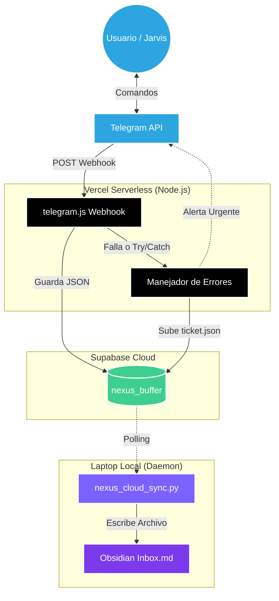
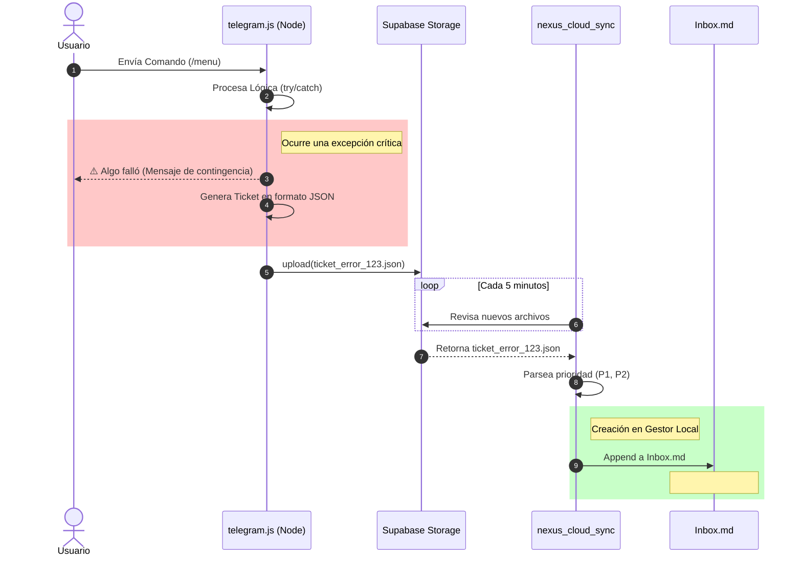

# 🏛️ Arquitectura: Gestor de Incidencias NEXUS

**Fecha:** 2026-09-21
**Inspiración:** Basado en el enfoque de Matt Pocock, que utiliza el gestor de incidencias (archivos locales, GitHub, Linear) como el cerebro/memoria a largo plazo de los agentes de IA.

---

## 💡 El Concepto
En lugar de depender de herramientas pesadas como Jira, NEXUS utilizará **Obsidian como su Gestor de Incidencias Local**. 

Cuando el sistema (como el webhook de Vercel) capture un error fatal (ej. 502 Bad Gateway), no fallará en silencio. Envolverá el error en un "Ticket", lo subirá a Supabase y el `nexus_cloud_sync` lo escribirá directamente en el `Inbox.md` de Obsidian con etiquetas `#bug` y prioridades para que sea atendido.

---

## 1. Arquitectura del Sistema (Macro)



---

## 2. Flujo de Secuencia: Ciclo de Vida de una Incidencia



---

## 3. Patrón de Implementación en Node.js (Vercel)

Implementaremos un patrón de "Error Boundary" en `telegram.js` para atrapar errores y enviarlos a la bóveda.

```javascript
// 1. Clase constructora del Ticket
class NexusTicket {
    constructor(error, context) {
        this.id = `INC-${Date.now()}`;
        this.priority = this.determinePriority(error);
        this.title = `Fallo en ${context.action || 'Webhook'}`;
        this.description = error.message;
        this.stack = error.stack;
        this.timestamp = new Date().toISOString();
        this.status = "TODO";
    }

    determinePriority(error) {
        if (error.message.includes('timeout') || error.message.includes('502')) return 'P1';
        return 'P3';
    }

    toObsidianMarkdown() {
        return `
### 🔴 [${this.priority}] ${this.title}
- **ID:** ${this.id}
- **Fecha:** ${this.timestamp}
- **Descripción:** ${this.description}
- **Estado:** [ ] Pendiente de revisión
- **Contexto técnico:**
\`\`\`text
${this.stack}
\`\`\`
---`;
    }
}

// 2. Wrapper para manejar todas las rutas y atrapar errores
async function withIncidentTracker(handlerFn, context) {
    try {
        return await handlerFn();
    } catch (error) {
        console.error("Error capturado por el Gestor de Incidencias:", error);
        
        const ticket = new NexusTicket(error, context);
        
        await supabase.storage
            .from('nexus_buffer')
            .upload(`pending/ticket_${ticket.id}.json`, JSON.stringify(ticket));
            
        await sendTelegramMessage(ADMIN_CHAT_ID, `⚠️ Nueva Incidencia ${ticket.priority}: ${ticket.title}`);
        
        return { statusCode: 200, body: 'Error logged' };
    }
}
```
